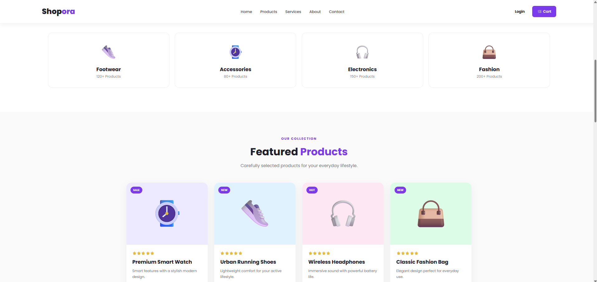
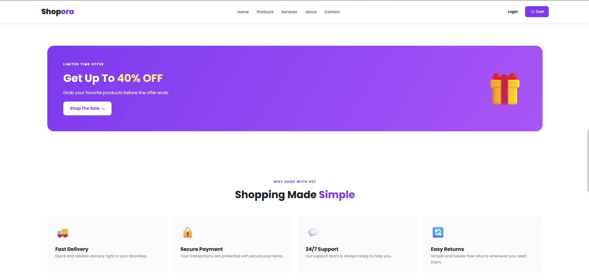
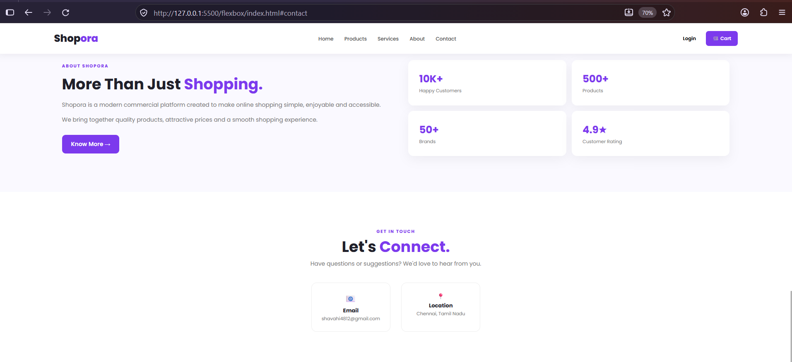
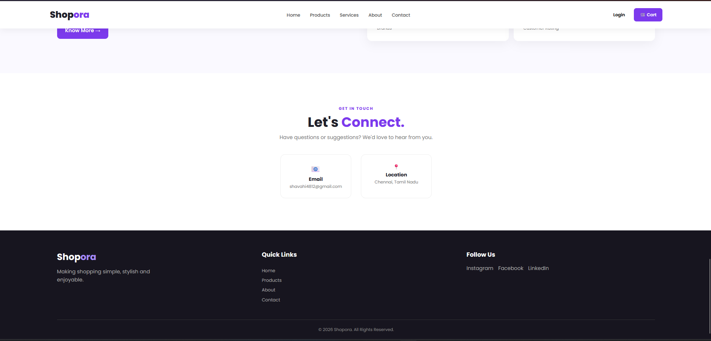

# flexbox
Ex02 Commercial Website
Date:02.11.2026
Name: Shamrin B
AIMTo create a commercial website using CSS Flexbox.
ALGORITHM
STEP 1
Create an HTML file (index.html)

STEP 2
Create a CSS file (style.css)

STEP 3
Include a navigation bar with links to different sections.

STEP 4
Add structured sections for Homepage, Products / Services, About Us, Contact Details and User Account.

STEP 5
Include social media links at the footer with copyright information.

STEP 6
Define global styles for fonts, colors, and layout.

STEP 7
Style the header, navigation bar, and sections.

STEP 8
Use Flexbox for layout design.

STEP 9
Add hover effects and transitions for interactivity.

STEP 10
Add Images and Media.

STEP 11
Use optimized images for a professional look.

STEP 12
Open the HTML file in a browser to check layout and functionality.

STEP 13
Fix styling issues and refine content placement.

STEP 14
Deploy the website.

STEP 15
Upload to GitHub Pages for free hosting.

PROGRAM
```
index.html

<!DOCTYPE html>
<html lang="en">

<head>
    <meta charset="UTF-8">
    <meta name="viewport" content="width=device-width, initial-scale=1.0">

    <title>Shopora | Modern Shopping</title>

    <link rel="stylesheet" href="style.css">

    <!-- Google Font -->
    <link rel="preconnect" href="https://fonts.googleapis.com">
    <link rel="preconnect" href="https://fonts.gstatic.com" crossorigin>
    <link href="https://fonts.googleapis.com/css2?family=Poppins:wght@300;400;500;600;700;800&display=swap"
        rel="stylesheet">
</head>

<body>

    <!-- ================= HEADER ================= -->

    <header>

        <nav class="navbar">

            <div class="logo">
                Shop<span>ora</span>
            </div>

            <ul class="nav-links">

                <li>
                    <a href="#home">Home</a>
                </li>

                <li>
                    <a href="#products">Products</a>
                </li>

                <li>
                    <a href="#services">Services</a>
                </li>

                <li>
                    <a href="#about">About</a>
                </li>

                <li>
                    <a href="#contact">Contact</a>
                </li>

            </ul>

            <div class="nav-buttons">

                <button class="login-btn">
                    Login
                </button>

                <button class="cart-btn">
                    🛒 Cart
                </button>

            </div>

        </nav>

    </header>


    <!-- ================= HERO ================= -->

    <section id="home" class="hero">

        <div class="hero-content">

            <p class="small-title">
                ✨ NEW COLLECTION 2026
            </p>

            <h1>
                Discover Your
                <span>Perfect Style.</span>
            </h1>

            <p class="hero-text">
                Explore premium products, stylish collections,
                and amazing deals — all in one place.
            </p>

            <div class="hero-buttons">

                <a href="#products" class="primary-btn">
                    Explore Products →
                </a>

                <a href="#about" class="secondary-btn">
                    Learn More
                </a>

            </div>

            <div class="hero-stats">

                <div>
                    <strong>10K+</strong>
                    <small>Customers</small>
                </div>

                <div>
                    <strong>500+</strong>
                    <small>Products</small>
                </div>

                <div>
                    <strong>4.9★</strong>
                    <small>Rating</small>
                </div>

            </div>

        </div>


        <div class="hero-image">

            <div class="circle">

                🛍️

            </div>

            <div class="floating-card card-one">
                ⭐ 4.9 Rating
            </div>

            <div class="floating-card card-two">
                🔥 30% OFF
            </div>

        </div>

    </section>


    <!-- ================= CATEGORIES ================= -->

    <section class="categories">

        <div class="section-heading">

            <p>SHOP BY CATEGORY</p>

            <h2>
                Find What You <span>Love</span>
            </h2>

        </div>

        <div class="category-container">

            <div class="category-card">
                <div class="category-icon">👟</div>
                <h3>Footwear</h3>
                <p>120+ Products</p>
            </div>

            <div class="category-card">
                <div class="category-icon">⌚</div>
                <h3>Accessories</h3>
                <p>80+ Products</p>
            </div>

            <div class="category-card">
                <div class="category-icon">🎧</div>
                <h3>Electronics</h3>
                <p>150+ Products</p>
            </div>

            <div class="category-card">
                <div class="category-icon">👜</div>
                <h3>Fashion</h3>
                <p>200+ Products</p>
            </div>

        </div>

    </section>


    <!-- ================= PRODUCTS ================= -->

    <section id="products" class="products">

        <div class="section-heading">

            <p>OUR COLLECTION</p>

            <h2>
                Featured <span>Products</span>
            </h2>

            <p class="description">
                Carefully selected products for your everyday lifestyle.
            </p>

        </div>


        <!-- FLEXBOX PRODUCT CONTAINER -->

        <div class="product-container">


            <!-- PRODUCT 1 -->

            <div class="product-card">

                <div class="product-image watch">
                    ⌚
                    <span class="sale">SALE</span>
                </div>

                <div class="product-info">

                    <div class="rating">
                        ⭐⭐⭐⭐⭐
                    </div>

                    <h3>Premium Smart Watch</h3>

                    <p>
                        Smart features with a stylish modern design.
                    </p>

                    <div class="price-row">

                        <div>
                            <span class="old-price">₹3,999</span>
                            <strong>₹2,499</strong>
                        </div>

                        <button class="buy-btn">
                            Add +
                        </button>

                    </div>

                </div>

            </div>


            <!-- PRODUCT 2 -->

            <div class="product-card">

                <div class="product-image shoes">
                    👟
                    <span class="sale">NEW</span>
                </div>

                <div class="product-info">

                    <div class="rating">
                        ⭐⭐⭐⭐⭐
                    </div>

                    <h3>Urban Running Shoes</h3>

                    <p>
                        Lightweight comfort for your active lifestyle.
                    </p>

                    <div class="price-row">

                        <div>
                            <span class="old-price">₹3,499</span>
                            <strong>₹2,199</strong>
                        </div>

                        <button class="buy-btn">
                            Add +
                        </button>

                    </div>

                </div>

            </div>


            <!-- PRODUCT 3 -->

            <div class="product-card">

                <div class="product-image headphones">
                    🎧
                    <span class="sale">HOT</span>
                </div>

                <div class="product-info">

                    <div class="rating">
                        ⭐⭐⭐⭐⭐
                    </div>

                    <h3>Wireless Headphones</h3>

                    <p>
                        Immersive sound with powerful battery life.
                    </p>

                    <div class="price-row">

                        <div>
                            <span class="old-price">₹2,999</span>
                            <strong>₹1,799</strong>
                        </div>

                        <button class="buy-btn">
                            Add +
                        </button>

                    </div>

                </div>

            </div>


            <!-- PRODUCT 4 -->

            <div class="product-card">

                <div class="product-image bag">
                    👜
                    <span class="sale">NEW</span>
                </div>

                <div class="product-info">

                    <div class="rating">
                        ⭐⭐⭐⭐⭐
                    </div>

                    <h3>Classic Fashion Bag</h3>

                    <p>
                        Elegant design perfect for everyday use.
                    </p>

                    <div class="price-row">

                        <div>
                            <span class="old-price">₹2,499</span>
                            <strong>₹1,499</strong>
                        </div>

                        <button class="buy-btn">
                            Add +
                        </button>

                    </div>

                </div>

            </div>

        </div>

    </section>


    <!-- ================= OFFER ================= -->

    <section class="offer">

        <div class="offer-content">

            <p>LIMITED TIME OFFER</p>

            <h2>
                Get Up To <span>40% OFF</span>
            </h2>

            <p>
                Grab your favorite products before the offer ends.
            </p>

            <a href="#products" class="offer-btn">
                Shop the Sale →
            </a>

        </div>

        <div class="offer-icon">
            🎁
        </div>

    </section>


    <!-- ================= SERVICES ================= -->

    <section id="services" class="services">

        <div class="section-heading">

            <p>WHY SHOP WITH US?</p>

            <h2>
                Shopping Made <span>Simple</span>
            </h2>

        </div>


        <!-- FLEXBOX SERVICES -->

        <div class="service-container">

            <div class="service-card">

                <div class="service-icon">
                    🚚
                </div>

                <h3>Fast Delivery</h3>

                <p>
                    Quick and reliable delivery right to your doorstep.
                </p>

            </div>


            <div class="service-card">

                <div class="service-icon">
                    🔒
                </div>

                <h3>Secure Payment</h3>

                <p>
                    Your transactions are protected with secure payments.
                </p>

            </div>


            <div class="service-card">

                <div class="service-icon">
                    💬
                </div>

                <h3>24/7 Support</h3>

                <p>
                    Our support team is always ready to help you.
                </p>

            </div>


            <div class="service-card">

                <div class="service-icon">
                    🔄
                </div>

                <h3>Easy Returns</h3>

                <p>
                    Simple and hassle-free returns whenever you need them.
                </p>

            </div>

        </div>

    </section>


    <!-- ================= ABOUT ================= -->

    <section id="about" class="about">

        <div class="about-content">

            <p>ABOUT SHOPORA</p>

            <h2>
                More Than Just
                <span>Shopping.</span>
            </h2>

            <p>
                Shopora is a modern commercial platform created to
                make online shopping simple, enjoyable and accessible.
            </p>

            <p>
                We bring together quality products, attractive prices
                and a smooth shopping experience.
            </p>

            <a href="#contact" class="primary-btn">
                Know More →
            </a>

        </div>


        <div class="about-box">

            <div>
                <strong>10K+</strong>
                <span>Happy Customers</span>
            </div>

            <div>
                <strong>500+</strong>
                <span>Products</span>
            </div>

            <div>
                <strong>50+</strong>
                <span>Brands</span>
            </div>

            <div>
                <strong>4.9★</strong>
                <span>Customer Rating</span>
            </div>

        </div>

    </section>


    <!-- ================= CONTACT ================= -->

    <section id="contact" class="contact">

        <div class="contact-content">

            <p>GET IN TOUCH</p>

            <h2>
                Let's <span>Connect.</span>
            </h2>

            <p>
                Have questions or suggestions?
                We'd love to hear from you.
            </p>

            <div class="contact-details">

                <div>
                    📧
                    <strong>Email</strong>
                    <span>shavahi4812@gmail.com</span>
                </div>

                <div>
                    📍
                    <strong>Location</strong>
                    <span>Chennai, Tamil Nadu</span>
                </div>

            </div>

        </div>

    </section>


    <!-- ================= FOOTER ================= -->

    <footer>

        <div class="footer-content">

            <div class="footer-brand">

                <h2>Shop<span>ora</span></h2>

                <p>
                    Making shopping simple, stylish and enjoyable.
                </p>

            </div>


            <div class="footer-links">

                <h3>Quick Links</h3>

                <a href="#home">Home</a>
                <a href="#products">Products</a>
                <a href="#about">About</a>
                <a href="#contact">Contact</a>

            </div>


            <div class="footer-social">

                <h3>Follow Us</h3>

                <div class="social-icons">

                    <a href="#">Instagram</a>
                    <a href="#">Facebook</a>
                    <a href="#">LinkedIn</a>

                </div>

            </div>

        </div>


        <div class="copyright">

            <p>
                © 2026 Shopora. All Rights Reserved.
            </p>

        </div>

    </footer>

</body>

</html>
```
```
Style.html
/* =========================
   RESET
========================= */

* {
    margin: 0;
    padding: 0;
    box-sizing: border-box;
}

html {
    scroll-behavior: smooth;
}

body {
    font-family: "Poppins", sans-serif;
    color: #20202a;
    background: #ffffff;
    line-height: 1.6;
}

a {
    text-decoration: none;
}

button {
    font-family: inherit;
    cursor: pointer;
}


/* =========================
   HEADER
========================= */

header {
    width: 100%;
    padding: 20px 7%;
    background: white;
    position: sticky;
    top: 0;
    z-index: 1000;
    box-shadow: 0 5px 20px rgba(0, 0, 0, 0.06);
}


/* FLEXBOX */

.navbar {
    display: flex;
    justify-content: space-between;
    align-items: center;
    gap: 30px;
}

.logo {
    font-size: 28px;
    font-weight: 800;
}

.logo span,
.section-heading span,
.about-content span,
.contact-content span {
    color: #7c3aed;
}

.nav-links {
    display: flex;
    align-items: center;
    gap: 30px;
    list-style: none;
}

.nav-links a {
    color: #555;
    font-size: 14px;
    font-weight: 500;
    transition: 0.3s;
}

.nav-links a:hover {
    color: #7c3aed;
}

.nav-buttons {
    display: flex;
    align-items: center;
    gap: 10px;
}

.login-btn,
.cart-btn {
    padding: 10px 18px;
    border-radius: 8px;
    border: none;
    font-weight: 600;
}

.login-btn {
    background: transparent;
}

.cart-btn {
    background: #7c3aed;
    color: white;
}


/* =========================
   HERO
========================= */

.hero {
    min-height: 680px;
    padding: 80px 8%;

    display: flex;
    justify-content: space-between;
    align-items: center;
    gap: 60px;

    background:
        radial-gradient(circle at 80% 20%,
        rgba(124, 58, 237, 0.15),
        transparent 30%),
        #faf9ff;
}

.hero-content {
    flex: 1;
    max-width: 650px;
}

.small-title {
    color: #7c3aed;
    font-size: 13px;
    font-weight: 700;
    letter-spacing: 2px;
    margin-bottom: 20px;
}

.hero h1 {
    font-size: clamp(45px, 6vw, 76px);
    line-height: 1.05;
    margin-bottom: 25px;
}

.hero h1 span {
    display: block;
    color: #7c3aed;
}

.hero-text {
    color: #666;
    max-width: 550px;
    margin-bottom: 35px;
}

.hero-buttons {
    display: flex;
    align-items: center;
    gap: 15px;
    flex-wrap: wrap;
}

.primary-btn,
.secondary-btn,
.offer-btn {
    display: inline-block;
    padding: 13px 25px;
    border-radius: 10px;
    font-weight: 600;
    transition: 0.3s;
}

.primary-btn {
    background: #7c3aed;
    color: white;
}

.primary-btn:hover {
    transform: translateY(-3px);
    box-shadow: 0 10px 25px rgba(124, 58, 237, 0.3);
}

.secondary-btn {
    border: 1px solid #ddd;
    color: #333;
    background: white;
}

.hero-stats {
    display: flex;
    gap: 45px;
    margin-top: 50px;
}

.hero-stats div {
    display: flex;
    flex-direction: column;
}

.hero-stats strong {
    font-size: 22px;
}

.hero-stats small {
    color: #777;
}

.hero-image {
    flex: 1;

    display: flex;
    justify-content: center;
    align-items: center;

    position: relative;
    min-height: 450px;
}

.circle {
    width: 330px;
    height: 330px;

    display: flex;
    justify-content: center;
    align-items: center;

    border-radius: 50%;

    font-size: 130px;

    background: linear-gradient(
        135deg,
        #7c3aed,
        #c084fc
    );

    box-shadow:
        0 30px 70px rgba(124, 58, 237, 0.3);
}

.floating-card {
    position: absolute;
    background: white;
    padding: 14px 20px;
    border-radius: 12px;
    box-shadow: 0 15px 35px rgba(0, 0, 0, 0.1);
    font-weight: 600;
}

.card-one {
    top: 70px;
    right: 20px;
}

.card-two {
    bottom: 70px;
    left: 30px;
}


/* =========================
   SECTION HEADING
========================= */

.section-heading {
    text-align: center;
    margin-bottom: 50px;
}

.section-heading > p:first-child {
    color: #7c3aed;
    font-size: 12px;
    font-weight: 700;
    letter-spacing: 2px;
}

.section-heading h2 {
    font-size: 38px;
    margin: 8px 0;
}

.description {
    color: #777;
}


/* =========================
   CATEGORIES
========================= */

.categories {
    padding: 90px 8%;
}

.category-container {

    /* FLEXBOX */

    display: flex;
    justify-content: center;
    align-items: stretch;

    gap: 20px;
    flex-wrap: wrap;
}

.category-card {
    flex: 1;
    min-width: 200px;

    text-align: center;

    padding: 30px 20px;

    border: 1px solid #eee;
    border-radius: 15px;

    transition: 0.3s;
}

.category-card:hover {
    transform: translateY(-8px);
    border-color: #c4b5fd;
    box-shadow: 0 15px 35px rgba(124, 58, 237, 0.1);
}

.category-icon {
    font-size: 50px;
    margin-bottom: 10px;
}

.category-card p {
    color: #888;
    font-size: 13px;
}


/* =========================
   PRODUCTS
========================= */

.products {
    padding: 90px 8%;
    background: #fafafa;
}

.product-container {

    /* MAIN FLEXBOX */

    display: flex;

    justify-content: center;
    align-items: stretch;

    gap: 25px;

    flex-wrap: wrap;
}

.product-card {
    flex: 1;

    min-width: 250px;
    max-width: 300px;

    background: white;

    border-radius: 18px;

    overflow: hidden;

    box-shadow: 0 10px 30px rgba(0, 0, 0, 0.05);

    transition: 0.3s;
}

.product-card:hover {
    transform: translateY(-10px);
    box-shadow: 0 20px 40px rgba(124, 58, 237, 0.15);
}

.product-image {
    height: 230px;

    display: flex;
    justify-content: center;
    align-items: center;

    position: relative;

    font-size: 100px;
}

.watch {
    background: #ede9fe;
}

.shoes {
    background: #e0f2fe;
}

.headphones {
    background: #fce7f3;
}

.bag {
    background: #dcfce7;
}

.sale {
    position: absolute;
    top: 15px;
    left: 15px;

    background: #7c3aed;
    color: white;

    padding: 5px 10px;

    border-radius: 20px;

    font-size: 10px;
    font-weight: 700;
}

.product-info {
    padding: 22px;
}

.rating {
    font-size: 12px;
    margin-bottom: 8px;
}

.product-info h3 {
    margin-bottom: 8px;
}

.product-info p {
    color: #777;
    font-size: 13px;
    margin-bottom: 20px;
}

.price-row {

    /* FLEXBOX */

    display: flex;
    justify-content: space-between;
    align-items: center;
}

.price-row div {
    display: flex;
    flex-direction: column;
}

.old-price {
    color: #aaa;
    text-decoration: line-through;
    font-size: 12px;
}

.price-row strong {
    font-size: 20px;
}

.buy-btn {
    border: none;
    background: #7c3aed;
    color: white;

    padding: 9px 15px;

    border-radius: 8px;

    font-weight: 600;
}


/* =========================
   OFFER
========================= */

.offer {

    /* FLEXBOX */

    display: flex;
    justify-content: space-between;
    align-items: center;

    gap: 30px;

    margin: 90px 8%;
    padding: 60px;

    border-radius: 25px;

    color: white;

    background:
        linear-gradient(
            120deg,
            #7c3aed,
            #a855f7
        );
}

.offer-content p:first-child {
    font-size: 12px;
    letter-spacing: 2px;
    font-weight: 700;
}

.offer h2 {
    font-size: 40px;
    margin: 10px 0;
}

.offer h2 span {
    color: #fde68a;
}

.offer-btn {
    margin-top: 20px;
    background: white;
    color: #7c3aed;
}

.offer-icon {
    font-size: 120px;
}


/* =========================
   SERVICES
========================= */

.services {
    padding: 90px 8%;
}

.service-container {

    /* FLEXBOX */

    display: flex;

    justify-content: center;
    align-items: stretch;

    gap: 20px;

    flex-wrap: wrap;
}

.service-card {
    flex: 1;

    min-width: 220px;

    padding: 30px;

    border-radius: 15px;

    background: #fafafa;

    transition: 0.3s;
}

.service-card:hover {
    background: #f5f3ff;
    transform: translateY(-5px);
}

.service-icon {
    font-size: 40px;
    margin-bottom: 15px;
}

.service-card p {
    color: #777;
    font-size: 14px;
}


/* =========================
   ABOUT
========================= */

.about {

    display: flex;
    justify-content: space-between;
    align-items: center;

    gap: 70px;

    padding: 100px 8%;

    background: #faf9ff;
}

.about-content {
    flex: 1;
}

.about-content > p:first-child {
    color: #7c3aed;
    font-size: 12px;
    font-weight: 700;
    letter-spacing: 2px;
}

.about-content h2 {
    font-size: 42px;
    line-height: 1.2;
    margin: 10px 0 20px;
}

.about-content p {
    color: #777;
    margin-bottom: 15px;
}

.about-content .primary-btn {
    margin-top: 15px;
}

.about-box {

    flex: 1;

    display: flex;

    flex-wrap: wrap;

    gap: 15px;
}

.about-box div {

    flex: 1 1 40%;

    padding: 30px;

    background: white;

    border-radius: 15px;

    box-shadow: 0 10px 30px rgba(0, 0, 0, 0.05);

    display: flex;
    flex-direction: column;
}

.about-box strong {
    font-size: 28px;
    color: #7c3aed;
}

.about-box span {
    color: #777;
    font-size: 13px;
}


/* =========================
   CONTACT
========================= */

.contact {
    padding: 100px 8%;
    text-align: center;
}

.contact-content > p:first-child {
    color: #7c3aed;
    font-size: 12px;
    font-weight: 700;
    letter-spacing: 2px;
}

.contact-content h2 {
    font-size: 42px;
}

.contact-content > p {
    color: #777;
}

.contact-details {

    display: flex;
    justify-content: center;

    gap: 30px;

    margin-top: 40px;

    flex-wrap: wrap;
}

.contact-details div {

    display: flex;
    flex-direction: column;

    min-width: 220px;

    padding: 25px;

    border: 1px solid #eee;
    border-radius: 15px;
}

.contact-details div:first-child {
    font-size: 25px;
}

.contact-details strong {
    font-size: 15px;
}

.contact-details span {
    color: #777;
    font-size: 13px;
}


/* =========================
   FOOTER
========================= */

footer {
    background: #17151f;
    color: white;

    padding: 60px 8% 20px;
}

.footer-content {

    /* FLEXBOX */

    display: flex;
    justify-content: space-between;
    align-items: flex-start;

    gap: 50px;
}

.footer-content > div {
    flex: 1;
}

.footer-brand h2 {
    font-size: 28px;
}

.footer-brand h2 span {
    color: #a78bfa;
}

.footer-brand p {
    color: #aaa;
    max-width: 300px;
    margin-top: 10px;
}

.footer-links {

    display: flex;
    flex-direction: column;

    gap: 8px;
}

.footer-links a {
    color: #aaa;
    font-size: 14px;
}

.footer-social h3,
.footer-links h3 {
    margin-bottom: 15px;
}

.social-icons {

    display: flex;

    gap: 15px;

    flex-wrap: wrap;
}

.social-icons a {
    color: #aaa;
}

.copyright {
    margin-top: 50px;
    padding-top: 20px;

    border-top: 1px solid #333;

    text-align: center;

    color: #888;
    font-size: 13px;
}


/* =========================
   RESPONSIVE DESIGN
========================= */

@media (max-width: 900px) {

    .nav-links {
        gap: 15px;
    }

    .hero {
        flex-direction: column;
        text-align: center;
    }

    .hero-text {
        margin-left: auto;
        margin-right: auto;
    }

    .hero-buttons,
    .hero-stats {
        justify-content: center;
    }

    .about {
        flex-direction: column;
    }

    .offer {
        flex-direction: column;
        text-align: center;
    }

    .footer-content {
        flex-wrap: wrap;
    }
}


@media (max-width: 650px) {

    header {
        padding: 15px 5%;
    }

    .navbar {
        flex-direction: column;
    }

    .nav-links {
        flex-direction: column;
        gap: 10px;
    }

    .hero {
        padding: 60px 5%;
    }

    .circle {
        width: 250px;
        height: 250px;
        font-size: 90px;
    }

    .hero-stats {
        gap: 20px;
    }

    .offer {
        margin: 50px 5%;
        padding: 40px 25px;
    }

    .offer h2 {
        font-size: 30px;
    }

    .about,
    .products,
    .services,
    .categories,
    .contact {
        padding-left: 5%;
        padding-right: 5%;
    }

    .footer-content {
        flex-direction: column;
    }
}

```
OUTPUT





RESULT
The program for creating commercial website using CSS Flexbox is executed successfully.